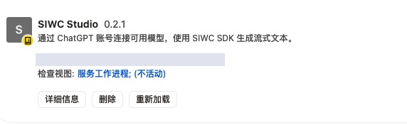
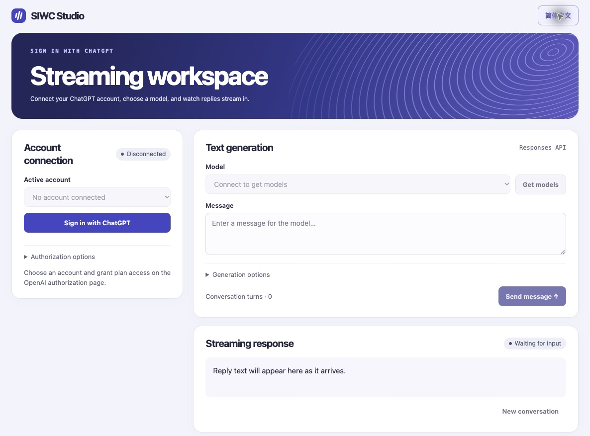
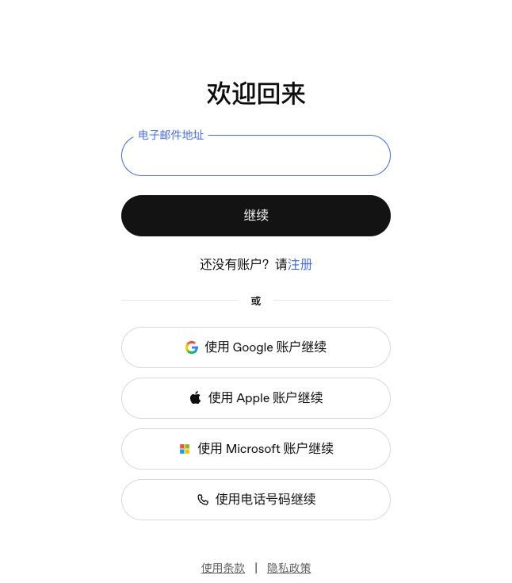

# Sign in with ChatGPT for Chrome Extensions

[简体中文](README.md) · English

This project adapts the Sign in with ChatGPT (SIWC) local SDK interface to Chrome Manifest V3 (MV3). A host extension can connect a user's ChatGPT account and, with their consent, use their ChatGPT plan to list available models and stream text. Sign-in, credential management, refresh, and API calls run inside the extension without a companion app, a server you maintain, or a developer API key.

Each release of this independent browser adaptation contains two ZIP attachments. Choose **SIWC SDK** to embed the modules in your extension or **SIWC Studio** for the ready-to-load demo. The demo connects to OpenAI with the permissions granted by your ChatGPT account. [Official SIWC developer guide](https://developers.openai.com/siwc/token-sharing-open-source)

## Use it in your extension

Bundle [`siwc/`](siwc) with your extension, register it in the extension service worker, and call `createChatGPT()` from a popup, options page, or side panel. The SDK has zero runtime dependencies and includes TypeScript declarations. Each host uses its own app name for authorization and keeps its accounts and credentials separate.

## What's included

| Location | Contents |
| --- | --- |
| [`siwc/client.js`](siwc/client.js) and [type declarations](siwc/client.d.ts) | Page client for sign-in, session subscriptions, account switching, model discovery, and streaming. |
| [`siwc/background.js`](siwc/background.js) and [background options](siwc/background.d.ts) | Service worker integration and lifecycle management for sign-in, profiles, and requests. |
| [`siwc/provider.js`](siwc/provider.js), [`siwc/callback.html`](siwc/callback.html), and [`siwc/store.js`](siwc/store.js) | OpenAI protocol and requests, the extension callback page, and IndexedDB credential storage. |
| [`demo/`](demo) | SIWC Studio extension source. The demo ZIP includes these files and the SDK. |

## Downloads

| Download from Releases | Use |
| --- | --- |
| **SIWC SDK** · `siwc-sdk-<version>.zip` | Extract and copy the included `siwc/` folder into your host extension. |
| **SIWC Studio** · `siwc-demo-<version>.zip` | Extract into its own directory. The ZIP includes a root manifest, the Studio interface, and the matching SDK. |

## Use SIWC Studio

Use desktop Chrome 121 or later. OpenAI determines model availability by account, region, and workspace. Click **English** or **简体中文** in the top right to switch languages at any time.

Microsoft Edge has been checked for unpacked installation, language switching, and opening the OpenAI sign-in page. End-to-end authorization, model discovery, and streaming still need to be verified in Edge.

### Load the extension

Extract the **SIWC Studio** release attachment. Open `chrome://extensions`, enable **Developer mode**, click **Load unpacked**, and select the extracted folder containing `manifest.json`. Click **SIWC Studio** on the toolbar to open the workspace.

<!-- screenshot: load-unpacked -->




### Sign in and grant access

Click **Sign in with ChatGPT**, choose your account and workspace on OpenAI's page, and grant plan usage. On return, the account card shows **Connected**. Expand **Authorization options** to set a callback port or an account label.

<!-- screenshot: openai-consent -->


### List available models

Click **Get models** and select a model available to the current account. For identity-only access, click **Grant plan access**. Fetch the list again after switching accounts.

<!-- screenshot: model-list -->
> Screenshot pending — The expanded model picker.

### Send text and watch the response stream

Enter a message and click **Send message**. The response panel shows incoming text, the delta count and completion status. Stop an active stream to keep the partial output. **Generation options** supports instructions and conversation context. **New conversation** clears the page’s current conversation.

<!-- screenshot: streaming-demo -->
> Screenshot pending — The selected model, prompt, and generated response.

## Integrate with a host extension

### Register the background worker and configure permissions

Place `siwc/` at the root of the host extension and register it once at the top level of the service worker module. Use `pages` to list the extension pages allowed to call the SDK. If the host already uses the default DNR rule ID `1`, pass an unused positive integer as `ruleId`.

```js
import { registerSiwcBackground } from "./siwc/background.js";

registerSiwcBackground({
  appName: "My Extension",
  pages: ["popup.html"],
  redirectPort: 51455,
});
```

Merge these fields into the host's MV3 manifest. If the extension already has a worker, register the SDK there and set its type to `module`. Declare the callback page as a web-accessible resource. [Chrome extension messaging](https://developer.chrome.com/docs/extensions/develop/concepts/messaging) · [Chrome redirect rules](https://developer.chrome.com/docs/extensions/reference/api/declarativeNetRequest)

```json
{
  "background": { "service_worker": "worker.js", "type": "module" },
  "permissions": ["alarms", "declarativeNetRequestWithHostAccess", "storage"],
  "host_permissions": ["http://127.0.0.1/*", "https://auth.openai.com/*", "https://api.openai.com/*"],
  "web_accessible_resources": [
    { "resources": ["siwc/callback.html"], "matches": ["http://127.0.0.1/*", "https://auth.openai.com/*"] }
  ]
}
```

### App name and identifiers

The demo extension sets `appName` to `SIWC Studio` in its own worker. In your host's `registerSiwcBackground()` call, use your actual product name consistently across installations. [Demo worker](demo/worker.js) · [Official authorization parameters](https://developers.openai.com/siwc/token-sharing-open-source/sign-in#2-start-authorization)

| Field | Source and purpose |
| --- | --- |
| `appName` | Set by the host. On initial dynamic registration, `agent_name_hint` prefills the app name on OpenAI's authorization page. The user can edit it before approval. |
| OAuth `client_id` | Initial registration uses `dynamic_agent_client`. OpenAI issues the actual ID in the callback. The SDK saves and reuses it per account registration. The public API does not accept a client ID override. |
| `ext_agent_host_id` | The SDK generates and persists a random UUID per host extension installation and reuses it on subsequent requests. The host does not supply it. |
| Chrome extension ID and Node SDK `appId` | The Chrome extension ID and origin isolate storage. The Node SDK's `appId` names local file storage. The Chrome adaptation does not require this option. |
| `profileId` and `label` | Use `profileId` to select a saved account. Use `label` to name it in the host's account list. Both are `signIn()` options. |

Changing `appName` leaves existing OpenAI registrations under their current names. To preview a new name, call `signIn({ newProfile: true })` from a user action to start a separate dynamic registration. [Official authorization parameters](https://developers.openai.com/siwc/token-sharing-open-source/sign-in#2-start-authorization)

### Make requests from an extension page

In this example, `#connect`, `#send`, `#prompt`, and `#output` are the connect button, send button, text input, and output area. Save the script as `popup.js` and load it as an ES module from `popup.html`. The example selects the first available model. The demo extension also demonstrates a model picker. [Demo page markup](demo/index.html) · [Demo page SDK calls](demo/index.js)

```js
import { createChatGPT } from "./siwc/client.js";

const chatgpt = createChatGPT();
const output = document.querySelector("#output");

function showError(error) {
  output.textContent = error.message;
}

document.querySelector("#connect").onclick = () =>
  chatgpt.signIn().catch(showError);

document.querySelector("#send").onclick = async () => {
  try {
    const [model] = await chatgpt.listModels();
    if (!model) {
      output.textContent = "No models are available for this account.";
      return;
    }
    output.textContent = "";
    const { text } = await chatgpt.streamResponse({
      model: model.slug,
      input: document.querySelector("#prompt").value,
      onDelta: delta => { output.textContent += delta; },
    });
    output.textContent = text;
  } catch (error) {
    showError(error);
  }
};
```

The popup may close when the authorization tab opens. The worker continues handling sign-in, and the page can use `getSession()` when it reopens. Enable model operations when `status === "connected"` and `sharing === true`. With identity-only access, `sharing` is `false`. From a user action, call `signIn({ reconsent: true })` to request plan usage.

### SDK API

The page client implements nine core methods with the same names as the official `@siwc/local` SDK. See the next section for differences in the Chrome adaptation. [Official interface](https://github.com/openai/sign-in-with-chatgpt-devkit/blob/0a36fefeb913055c8c7a1a29b63d82b96b2e841a/packages/local/src/types.ts#L93) · [Chrome interface](siwc/client.d.ts)

| Method | Return value and behavior |
| --- | --- |
| `signIn(options?)` | `Promise<SessionState>`. Opens OpenAI authorization from a user action. Supports `signal`, `newProfile`, `profileId`, `label`, `reconsent`, and the Chrome-specific `port`. |
| `cancelSignIn()` | Returns `void` and cancels the current authorization. A waiting `signIn()` rejects with `cancelled`. |
| `getSession()` | `Promise<SessionState>`. Status is `disconnected`, `connecting`, `connected`, or `reauth_required`, alongside `sharing` and optional identity details. |
| `subscribe(listener)` | Subscribes to session state, delivers the initial snapshot asynchronously, and returns an unsubscribe function. |
| `listProfiles()` | `Promise<LoginProfile[]>`. Lists verified account registrations. Call `signIn({ newProfile: true })` to add an account. |
| `selectProfile(id)` | `Promise<SessionState>`. Changes the active account. Fetch models again to update the UI. |
| `listModels(options?)` | `Promise<ChatGPTModel[]>`. Each model has a `slug` and `displayName`. Use the `slug` for inference. Accepts a `signal`. |
| `streamResponse(options)` | `Promise<{ text: string }>`. Takes `model` and `input`, with optional `instructions`, `onDelta`, and `signal`. Pass a string or an array of `{ role, content }` messages with `user`, `assistant`, or `developer` roles. Returns the full text after `response.completed`. |
| `disconnect()` | `Promise<void>`. Clears the selected account's local credentials and requests remote revocation. Keeps the registration for future sign-in and preserves other accounts' credentials. |

`createSiwcClient()`, `onSessionChanged()`, and `generateText()` are aliases for `createChatGPT()`, `subscribe()`, and `streamResponse()`, respectively. `generateText()` uses the streaming API.

### Differences from the official Node.js SDK

| Upstream feature or option | Chrome adaptation |
| --- | --- |
| `createChatGPT(config)` and `appId` | Configure the background through `registerSiwcBackground()` and call `createChatGPT()` without arguments from the page. The Chrome extension ID and origin isolate the host's data. |
| `redirectPort: 0` and `openBrowser` | The worker opens a Chrome tab. The extension cannot ask the OS to allocate an available port through a TCP listener. Choose a fixed port in `1024–65535`, with `51455` as the default. |
| `storageDir` and `credentialEncryption` | The SDK manages IndexedDB and its Web Crypto key. There are no filesystem or OS credential vault options. |
| `sendHostId` | Registration always sends the persisted host ID for this extension installation. |
| `id_token_hint`, legacy localhost migration, and `LoginProfile.pending` | Only accounts that have completed code exchange and verification appear in the list. Returning sign-ins reuse verified registration IDs. The adaptation omits the previous ID token hint and migration of upstream localhost or pending registrations. |
| Worker lifecycle | Streaming deltas and cancellation travel over an extension message port. If the calling page closes or the worker is interrupted, the host handles the ended request. |
| `@siwc/react` and design assets | The SDK supplies logic and state. The host builds the UI for sign-in, account selection, and plan authorization status. |

### Errors and recovery

Import `SiwcError` from `siwc/client.js`. Handle failures by `code`. The `retryable` flag indicates whether retry is appropriate, and `status` and `requestId` are provided when available. [Official errors and recovery guide](https://developers.openai.com/siwc/token-sharing-open-source/errors-and-recovery)

| Common error | Host action |
| --- | --- |
| `auth_required`, `reauth_required`, `plan_scope_missing` | Prompt the user to sign in, authorize again, or grant plan usage. |
| `sign_in_pending` | Prompt the user to complete or cancel the current authorization. |
| `refresh_not_ready`, `verification_unavailable`, `network_error`, `timeout` | Show temporary unavailability and allow a later retry. |
| `stream_incomplete`, `response_failed`, `request_interrupted`, `cancelled` | End the current operation and show its status. Let the user decide whether to send a new request. |
| `remote_revocation_unconfirmed` | Local credentials have been cleared. Direct the user to ChatGPT Settings to disconnect the app. |
| `background_unavailable` | Check worker registration, the page's inclusion in `pages`, and that the extension is enabled. |

## Authorization, refresh, and credential security

### From authorization to inference

1. The worker generates OAuth `state`, an OIDC `nonce`, and a PKCE verifier, saves a one-time authorization transaction, and opens OpenAI's authorization page. The redirect URI registered with OpenAI is `http://127.0.0.1:<port>/auth/callback`. The port is configurable.
2. A temporary Chrome DNR rule matches GET main-frame navigations to the specified port and path in the authorization tab and redirects the loopback callback to an extension page. The page clears the URL parameters and passes the callback to the worker.
3. The worker checks the tab, `state`, and expiration, then consumes the transaction. It exchanges the code using the original loopback URI, issued `client_id`, and PKCE verifier. It validates the signature against OpenAI's JWKS, issuer, audience, nonce, and granted scopes before saving the session.
4. The worker uses the OAuth access token with plan usage permission for `GET /v1/models` and `POST /v1/responses`. Inference sends a normalized input array with `store: false` and `stream: true` and treats `response.completed` as success. [Official authorization flow](https://developers.openai.com/siwc/token-sharing-open-source/sign-in) · [Models and inference](https://developers.openai.com/siwc/token-sharing-open-source/models-and-inference)

The DNR loopback bridge draws on the Loom.js Codex experiment. This project uses SIWC dynamic registration and the public Responses API. [Loom.js experiment notes](https://github.com/mgravey/loom.js/blob/ad0d6483465e9fc546b7e2d5b4b005dd3c19e8b9/docs/codex-auth-experiment.md)

### Automatic refresh

`listModels()` and `streamResponse()` check the access token before making a request. The SDK refreshes on demand when the token is within 60 seconds of expiration and OpenAI's `earliest_refresh_at` has been reached. It makes no idle refresh requests. Concurrent calls share the token rotation and then make their own API requests.

A successful refresh rotates the refresh token. If the response contains an ID token to verify, the worker saves the rotation encrypted first. If JWKS is temporarily unavailable or the worker restarts, the next request can resume verification. When OpenAI reports an invalid or expired refresh token, the SDK clears the credentials and enters `reauth_required`. Authorization may also be required if the server rotates the token and the browser fails to receive or save the result. [Official refresh rules](https://developers.openai.com/siwc/token-sharing-open-source/profiles-and-sessions#refreshing-tokens)

### Storage and trust boundary

The SDK manages credential storage. The worker saves credentials in extension IndexedDB encrypted with AES-GCM. IndexedDB also persists the 256-bit Web Crypto `CryptoKey`. Sessions can survive a Chrome restart when the same browser profile and extension ID are in use, local data is retained, and authorization is valid. Earlier sessions can migrate when their legacy key is still available. Accounts whose legacy key was lost require sign-in again.

`extractable: false` applies to the `CryptoKey` export operation. Bearer token strings can still be copied, and host code running in the same extension origin can obtain the key and use it to decrypt. Credentials are stored as ciphertext and rely on trusted host extension code, without the separate protection of an OS credential vault. The SDK's page API returns public session state, models, and inference results. [Web Crypto key interface](https://www.w3.org/TR/webcrypto/#cryptokey-interface)

## UI guidelines and preview limitations

- `sharing` indicates that the active account granted plan access. The SDK exposes authorization state, available models, and streamed text. ChatGPT Settings shows plan usage and remaining allowance. [OpenAI usage guidance](https://developers.openai.com/siwc/token-sharing-open-source/profiles-and-sessions#tracking-usage)
- The interface supports text. For multi-turn interactions, the host sends message history. The current interface omits images, tools, and history management. Model lookup and inference time out after 15 and 90 seconds respectively and are subject to the MV3 worker lifecycle. [SIWC preview limitations](https://developers.openai.com/siwc/token-sharing-open-source/preview-limitations) · [Chrome worker lifecycle](https://developer.chrome.com/docs/extensions/develop/concepts/service-workers/lifecycle)
- Authorization transactions expire after 10 minutes. Restarting Chrome interrupts authorization in progress. Changing the Chrome profile or extension ID, uninstalling the extension, or clearing its data can make a saved session unavailable.
- OpenAI's public guide specifies a loopback listener and says to keep tokens in protected runtime storage and out of browser storage. This project's DNR bridge and encrypted IndexedDB persistence are compatibility experiments. Confirm OpenAI's support and the applicable terms before distributing this implementation for use. [Registration and callback guide](https://developers.openai.com/siwc/token-sharing-open-source/sign-in) · [Official credential storage guidance](https://developers.openai.com/siwc/token-sharing-open-source/profiles-and-sessions#credential-security) · [SIWC terms](https://openai.com/policies/sign-in-with-chatgpt-terms/)

## Upstream and related projects

- The official DevKit repository contains `@siwc/local`, `@siwc/react`, examples, and licensing information. The Paste Perfect tutorial walks through an integration. [Official DevKit](https://github.com/openai/sign-in-with-chatgpt-devkit) · [Paste Perfect Cookbook](https://developers.openai.com/cookbook/articles/sign-in-with-chatgpt) · [Upstream license](https://github.com/openai/sign-in-with-chatgpt-devkit/blob/main/LICENSE)
- Detent implements SIWC registration and callback bridging in Chrome. Midscene offers ChatGPT plan inference and refresh in its browser extension. [Detent](https://github.com/Mnigos/detent/blob/ac9db6a5ab07250aa5f0f350fcd0ba6a66b5ec21/README.md) · [Midscene](https://v1.midscenejs.com/chatgpt-subscription#usage-and-credentials)
- byok provides an MV3 SDK and uses Codex device authorization to connect ChatGPT. TanStack AI provides an SIWC SDK entry point and uses a local callback server in its examples. [byok](https://github.com/amenophis1er/byok#install) · [TanStack AI](https://github.com/TanStack/ai/pull/1574)
