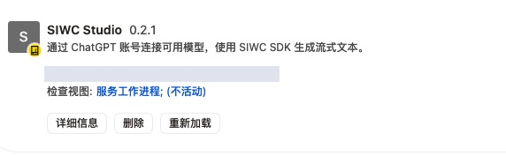
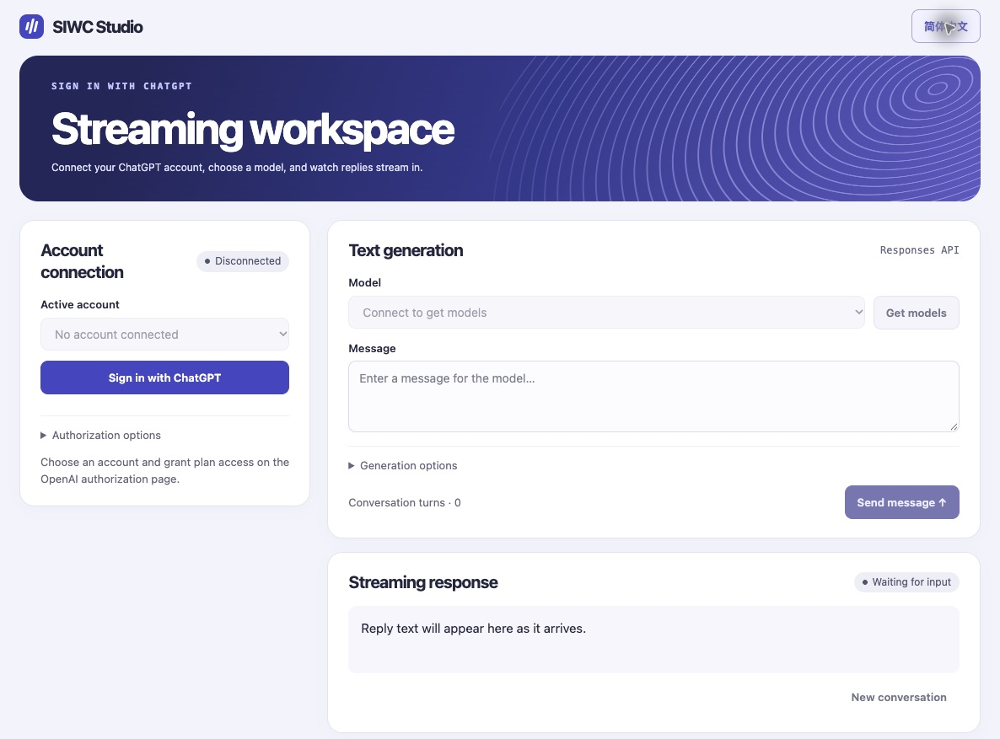
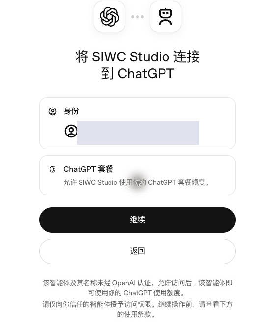
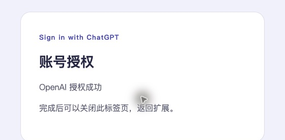
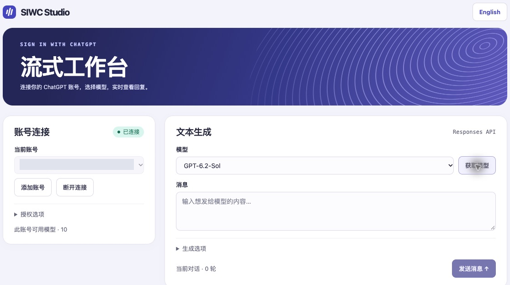
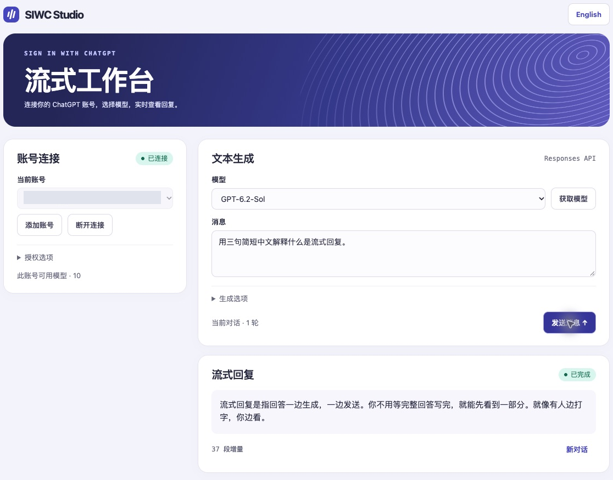

# Sign in with ChatGPT for Chrome Extensions

简体中文 · [English](README.en.md)

这个项目把 Sign in with ChatGPT（SIWC）的本地 SDK 接口适配到 Chrome Manifest V3（MV3）。宿主扩展可以让用户连接 ChatGPT 账号，并在用户同意后使用其 ChatGPT 套餐查询可用模型和流式生成文本。登录、凭证管理、续期和 API 调用都在扩展内运行，无需额外的本机应用、服务器或开发者 API key。

**SIWC Studio 是为展示 SIWC SDK 用法而推出的 Demo 扩展。** 它内置 SDK，演示如何用 ChatGPT 套餐完成账号授权、查询模型和生成流式回复。每个发行版都提供两个 ZIP，分别供开发者集成 SDK 和体验这个 Demo。 [官方 SIWC 开发指南](https://developers.openai.com/siwc/token-sharing-open-source)

## 在你的扩展中使用

把 [`siwc/`](siwc) 随宿主扩展打包，在扩展后台 Service Worker 注册，再从弹窗、选项页或侧边栏调用 `createChatGPT()`。SDK 无运行时依赖，附带 TypeScript 类型。每个宿主以自己的应用名称发起授权，独立保存自己的账号和凭证。

## 项目包含什么

| 位置 | 内容 |
| --- | --- |
| [`siwc/client.js`](siwc/client.js) 和 [类型声明](siwc/client.d.ts) | 宿主页面调用入口，提供授权、状态订阅、账号切换、模型列表和流式推理。 |
| [`siwc/background.js`](siwc/background.js) 和 [后台配置类型](siwc/background.d.ts) | Service Worker 接入，以及授权事务、账号和请求生命周期管理。 |
| [`siwc/provider.js`](siwc/provider.js)、[`siwc/callback.html`](siwc/callback.html) 和 [`siwc/store.js`](siwc/store.js) | OpenAI 协议和调用、扩展内的回调页和 IndexedDB 凭证存储。 |
| [`demo/`](demo) | SIWC Studio 演示扩展源码。演示 ZIP 包含这些文件和配套 SDK。 |

## 下载

| 在 Releases 中下载 | 用法 |
| --- | --- |
| **SIWC SDK** · `siwc-sdk-<version>.zip` | 解压后，将其中的 `siwc/` 目录复制进宿主扩展。 |
| **SIWC Studio** · `siwc-demo-<version>.zip` | 解压到单独的目录。ZIP 根目录包含扩展 manifest、Studio 界面和配套 SDK。 |

## 运行 SIWC Studio Demo

使用桌面 Chrome 121 或更新版本。模型可用性由 OpenAI 按账号、地区和工作区决定。点击右上角的 **English** 或 **简体中文** 可随时切换界面语言。

**Chrome 端到端实测通过。** 使用真实 ChatGPT 套餐完成了 OpenAI 授权和回调、模型查询及流式回复。Studio 查到 10 个可用模型，并使用 GPT-6.2-Sol 完成了一次流式回复，共收到 37 段增量。下方截图来自这次实测。

**Microsoft Edge 端到端实测通过。** 使用桌面 Edge 158.0.4370.33 加载 Studio v0.2.3，完成真实 OpenAI 授权和回调，查到 10 个可用模型，并使用 GPT-6.2-Sol 完成流式回复，共收到 27 段增量。

### 加载扩展

解压 **SIWC Studio** 附件，在 `chrome://extensions` 打开「开发者模式」，点击「加载未打包的扩展程序」，选择包含 `manifest.json` 的解压目录。点击工具栏中的 **SIWC Studio** 打开流式工作台。

<!-- screenshot: load-unpacked -->




### 登录并授权

点击「使用 ChatGPT 登录」，在 OpenAI 页面选择账号和工作区，并授予套餐用量权限。返回工作台后，「账号连接」显示「已连接」。通过「授权选项」可指定回调端口和账号备注。

<!-- screenshot: openai-consent -->




### 查看可用模型

点击「获取模型」，从下拉菜单中选择当前账号可用的模型。若仅授予了身份权限，点击「授权套餐用量」补授权限。切换账号后请重新获取模型。

<!-- screenshot: model-list -->


### 发送文本并观察流式输出

输入消息，点击「发送消息」。在「流式回复」中可以看到实际增量、完成状态和中途停止后保留的文本。「生成选项」支持模型指令和多轮上下文。「新对话」清空当前页面的对话历史。

<!-- screenshot: streaming-demo -->


## 集成到宿主扩展

### 注册后台和配置权限

将 `siwc/` 放到宿主扩展根目录，在 ES 模块 Service Worker 顶层注册一次。用 `pages` 声明允许调用 SDK 的扩展页面路径。如果宿主的 DNR 已经使用默认的规则 ID `1`，请传入未占用的正整数 `ruleId`。

```js
import { registerSiwcBackground } from "./siwc/background.js";

registerSiwcBackground({
  appName: "My Extension",
  pages: ["popup.html"],
  redirectPort: 51455,
});
```

将这些字段合并到宿主的 MV3 manifest。已有 Worker 时，在该 Worker 中完成注册并将类型设为 `module`。回调页需声明为 Web Accessible Resource。 [Chrome 扩展消息](https://developer.chrome.com/docs/extensions/develop/concepts/messaging) · [Chrome 回调重定向规则](https://developer.chrome.com/docs/extensions/reference/api/declarativeNetRequest)

```json
{
  "background": { "service_worker": "worker.js", "type": "module" },
  "permissions": ["alarms", "declarativeNetRequestWithHostAccess", "storage"],
  "host_permissions": ["http://127.0.0.1/*", "https://auth.openai.com/*", "https://api.openai.com/*"],
  "web_accessible_resources": [
    { "resources": ["siwc/callback.html"], "matches": ["http://127.0.0.1/*", "https://auth.openai.com/*"] }
  ]
}
```

### 应用名称与标识符

演示扩展在自己的 Worker 中把 `appName` 设为 `SIWC Studio`。宿主接入时，在自己的 `registerSiwcBackground()` 中填写实际产品名称，并在各安装实例中保持一致。 [演示扩展 Worker](demo/worker.js) · [官方授权参数](https://developers.openai.com/siwc/token-sharing-open-source/sign-in#2-start-authorization)

| 字段 | 来源和用途 |
| --- | --- |
| `appName` | 由宿主设置。首次动态注册时通过 `agent_name_hint` 预填 OpenAI 授权页的应用名，用户可以在确认前编辑。 |
| OAuth `client_id` | 首次注册使用 `dynamic_agent_client`，OpenAI 在回调中签发实际 ID。SDK 按账号注册保存并复用它，公开接口不支持传入或覆盖这个 ID。 |
| `ext_agent_host_id` | SDK 为每个宿主扩展安装生成并保存的随机 UUID，后续请求复用它。无需由宿主传入。 |
| Chrome 扩展 ID 与 Node SDK 的 `appId` | Chrome 的扩展 ID 和扩展域负责数据隔离。Node SDK 的 `appId` 用于本地文件存储命名，Chrome 版无需配置这个字段。 |
| `profileId` 与 `label` | `profileId` 选择 SDK 中已有的账号，`label` 设置宿主账号列表中的本地名称。这两个字段都可传给 `signIn()`。 |

更改 `appName` 不会重命名已有的 OpenAI 注册。预览新名称时，可在用户点击后调用 `signIn({ newProfile: true })`，发起一次独立的动态注册。 [官方授权参数](https://developers.openai.com/siwc/token-sharing-open-source/sign-in#2-start-authorization)

### 从页面发起请求

以下代码示例中的 `#connect`、`#send`、`#prompt` 和 `#output` 对应宿主页面的连接按钮、发送按钮、文本输入和输出区。将代码保存为 `popup.js`，并从 `popup.html` 作为 ES 模块加载。示例直接选用第一个可用模型，演示扩展也演示了如何提供模型选择器。 [演示页源码](demo/index.html) · [演示页的 SDK 调用](demo/index.js)

```js
import { createChatGPT } from "./siwc/client.js";

const chatgpt = createChatGPT();
const output = document.querySelector("#output");

function showError(error) {
  output.textContent = error.message;
}

document.querySelector("#connect").onclick = () =>
  chatgpt.signIn().catch(showError);

document.querySelector("#send").onclick = async () => {
  try {
    const [model] = await chatgpt.listModels();
    if (!model) {
      output.textContent = "当前账号没有可用模型。";
      return;
    }
    output.textContent = "";
    const { text } = await chatgpt.streamResponse({
      model: model.slug,
      input: document.querySelector("#prompt").value,
      onDelta: delta => { output.textContent += delta; },
    });
    output.textContent = text;
  } catch (error) {
    showError(error);
  }
};
```

弹窗可能在授权标签页打开时关闭。后台继续处理授权，页面重新打开时可用 `getSession()` 获取状态。宿主应在 `status === "connected"` 且 `sharing === true` 时启用模型操作。仅授予身份权限时 `sharing` 为 `false`，可由用户点击触发 `signIn({ reconsent: true })` 补授权限。

### SDK 接口

页面客户端提供九个与官方 `@siwc/local` 同名的核心方法。Chrome 的适配差异见下节。 [官方接口定义](https://github.com/openai/sign-in-with-chatgpt-devkit/blob/0a36fefeb913055c8c7a1a29b63d82b96b2e841a/packages/local/src/types.ts#L93) · [Chrome 接口定义](siwc/client.d.ts)

| 接口 | 返回值与行为 |
| --- | --- |
| `signIn(options?)` | `Promise<SessionState>`。在用户点击后打开 OpenAI 授权。支持 `signal`、`newProfile`、`profileId`、`label`、`reconsent`，以及 Chrome 适配新增的 `port`。 |
| `cancelSignIn()` | 返回 `void`，取消当前授权，等待中的 `signIn()` 以 `cancelled` 失败。 |
| `getSession()` | `Promise<SessionState>`。会话状态有 `disconnected`、`connecting`、`connected`、`reauth_required`，另有 `sharing` 和可选的身份信息。 |
| `subscribe(listener)` | 订阅会话状态，异步发出初始快照，并返回取消订阅函数。 |
| `listProfiles()` | `Promise<LoginProfile[]>`。列出已验证的账号注册。调用 `signIn({ newProfile: true })` 添加账号。 |
| `selectProfile(id)` | `Promise<SessionState>`。切换当前账号。重新读取模型列表以更新界面。 |
| `listModels(options?)` | `Promise<ChatGPTModel[]>`。每项包含 `slug` 和 `displayName`，推理使用 `slug`。支持传入 `signal`。 |
| `streamResponse(options)` | `Promise<{ text: string }>`。接收 `model` 和 `input`，支持 `instructions`、`onDelta` 和 `signal`。输入可以是一段文本或 `{ role, content }[]`，角色支持 `user`、`assistant` 和 `developer`。收到 `response.completed` 后返回全文。 |
| `disconnect()` | `Promise<void>`。清除所选账号的本地授权并请求远端撤销，保留原账号注册供重新授权。其他账号的凭证继续保留。 |

`createSiwcClient()`、`onSessionChanged()` 和 `generateText()` 分别是 `createChatGPT()`、`subscribe()` 和 `streamResponse()` 的别名。`generateText()` 同样使用流式接口。

### 与官方 Node.js SDK 的差异

| 官方能力或配置 | Chrome 适配 |
| --- | --- |
| `createChatGPT(config)` 和 `appId` | 由后台 `registerSiwcBackground()` 接收配置，页面使用无参数的 `createChatGPT()`。Chrome 扩展 ID 和扩展域隔离各宿主的数据。 |
| `redirectPort: 0` 和 `openBrowser` | 由 Worker 打开 Chrome 标签页。扩展无法用 TCP listener 向 OS 申请空闲端口，支持固定的 `1024–65535`，默认 `51455`。 |
| `storageDir` 和 `credentialEncryption` | SDK 管理 IndexedDB 和 Web Crypto 密钥。宿主没有文件目录或 OS 凭证库选项。 |
| `sendHostId` | 注册时始终发送本次扩展安装持久化的 host ID。 |
| `id_token_hint`、旧 localhost 注册迁移和 `LoginProfile.pending` | 仅列出已经换码并通过验证的账号。回访使用已验证的注册 ID。当前省略历史 ID token 提示，也未迁移官方 SDK 的 localhost 注册或暂存账号。 |
| Worker 生命周期 | 增量和取消通过扩展消息端口传输。调用页面关闭或 Worker 中断时，本次推理结束，由宿主处理。 |
| `@siwc/react` 和设计资源 | SDK 提供逻辑和状态，登录、账号选择和套餐授权状态界面由宿主实现。 |

### 错误与恢复

从 `siwc/client.js` 导入 `SiwcError`。按 `code` 处理，`retryable` 表示错误可否重试，`status` 和 `requestId` 在可用时提供。 [官方错误与恢复指南](https://developers.openai.com/siwc/token-sharing-open-source/errors-and-recovery)

| 典型错误 | 宿主处理 |
| --- | --- |
| `auth_required`、`reauth_required`、`plan_scope_missing` | 引导用户登录、重新授权或补授套餐用量。 |
| `sign_in_pending` | 引导用户完成或取消现有授权。 |
| `refresh_not_ready`、`verification_unavailable`、`network_error`、`timeout` | 显示暂时不可用，让用户稍后重试。 |
| `stream_incomplete`、`response_failed`、`request_interrupted`、`cancelled` | 结束当前操作并显示相应状态。发送新请求由用户决定。 |
| `remote_revocation_unconfirmed` | 本地凭证已经清除，可引导用户前往 ChatGPT 设置取消应用授权。 |
| `background_unavailable` | 检查 Worker 注册、当前页面是否在 `pages` 中，以及扩展是否启用。 |

## 授权、续期和凭证安全

### 从授权到推理

1. Worker 生成 OAuth `state`、OIDC `nonce` 和 PKCE verifier，保存一次性授权事务后，打开 OpenAI 授权页。向 OpenAI 申报的回调是 `http://127.0.0.1:<port>/auth/callback`，只有端口可调整。
2. Chrome DNR 临时规则只匹配授权标签页中指定端口与路径的 GET 主框架导航，将回环回调转到扩展内的回调页。回调页清除地址栏参数，再交给 Worker 校验。
3. Worker 核对标签页、`state` 和有效期并消费事务，用原回环 URI、已签发的 `client_id` 和 PKCE verifier 换码。校验 OpenAI JWKS 签名、issuer、audience、nonce 及授权范围后保存会话。
4. Worker 用获准使用套餐的 OAuth access token 请求 `GET /v1/models` 和 `POST /v1/responses`。推理发送标准化的输入数组，设置 `store: false` 和 `stream: true`，以 `response.completed` 确认成功。 [官方授权流程](https://developers.openai.com/siwc/token-sharing-open-source/sign-in) · [模型和推理](https://developers.openai.com/siwc/token-sharing-open-source/models-and-inference)

DNR 回环桥接参考了 Loom.js 的 Codex 实验，本项目接入的是 SIWC 动态注册和公开 Responses API。 [Loom.js 实验笔记](https://github.com/mgravey/loom.js/blob/ad0d6483465e9fc546b7e2d5b4b005dd3c19e8b9/docs/codex-auth-experiment.md)

### 自动续期

`listModels()` 和 `streamResponse()` 调用前会检查 access token。在到期前 60 秒内、且达到 OpenAI 的 `earliest_refresh_at` 时按需续期。空闲时不发送续期请求。并发调用共用一次轮换，随后各自调用 API。

成功刷新会得到新的 refresh token。若刷新响应带有需要验证的 ID token，Worker 先加密保存轮换结果。遇到 JWKS 服务暂不可用或 Worker 重启，下次请求可继续验证。若 OpenAI 确认 refresh token 无效或过期，SDK 会清除凭证并进入 `reauth_required`。若服务端已轮换，而本地未能收到或保存结果，也可能需要重新授权。 [官方刷新规则](https://developers.openai.com/siwc/token-sharing-open-source/profiles-and-sessions#refreshing-tokens)

### 存储与信任边界

凭证由 SDK 保存。Worker 将凭证以 AES-GCM 加密后写入扩展 IndexedDB，256 位 Web Crypto `CryptoKey` 也由 IndexedDB 持久化。同一 Chrome 配置及扩展 ID 重启后可继续使用原有凭证，前提是本地数据仍在且授权有效。来自早期实现的会话在旧密钥可用时可迁移，旧密钥已丢失的账号须重新授权。

`extractable: false` 限制的是 `CryptoKey` 的导出。Bearer token 字符串仍可复制，能在同一扩展源执行的宿主代码也能取得密钥并调用解密。此设计在数据库中保存的是密文，依赖宿主扩展代码受信任，并且没有 OS 凭证库提供的独立保护。SDK 的页面接口只返回公开状态、模型和推理结果。 [Web Crypto 密钥接口](https://www.w3.org/TR/webcrypto/#cryptokey-interface)

## 界面指南与预览限制

- `sharing` 表示当前账号已授权使用套餐。SDK 提供授权状态、可用模型和流式文本，套餐用量和剩余额度由 ChatGPT 设置页面提供。 [OpenAI 用量说明](https://developers.openai.com/siwc/token-sharing-open-source/profiles-and-sessions#tracking-usage)
- 当前接口支持文本。多轮对话由宿主传入消息历史，图片、工具调用和会话历史管理暂未提供。模型查询与推理的请求时限分别为 15 秒和 90 秒，同时受 MV3 Worker 生命周期约束。 [SIWC 预览限制](https://developers.openai.com/siwc/token-sharing-open-source/preview-limitations) · [Chrome Worker 生命周期](https://developer.chrome.com/docs/extensions/develop/concepts/service-workers/lifecycle)
- 授权事务有效期为 10 分钟，浏览器重启后需重新发起尚未完成的授权。更换 Chrome 配置或扩展 ID、卸载扩展、清除扩展数据可能使已保存的会话无法恢复。
- OpenAI 的公开指南要求使用回环监听，并明确要求 token 保存在受保护的运行时存储、避开浏览器存储。本项目的 DNR 桥接和 IndexedDB 密文持久化属于兼容性实验，正式分发使用前需确认 OpenAI 对该实现的支持及适用条款。 [注册与回调指南](https://developers.openai.com/siwc/token-sharing-open-source/sign-in) · [官方凭证存储要求](https://developers.openai.com/siwc/token-sharing-open-source/profiles-and-sessions#credential-security) · [SIWC 服务条款](https://openai.com/policies/sign-in-with-chatgpt-terms/)

## 上游与相关项目

- 官方 DevKit 的 `@siwc/local`、`@siwc/react`、示例和许可证见上游仓库，逐步接入见 Paste Perfect 教程。 [官方 DevKit](https://github.com/openai/sign-in-with-chatgpt-devkit) · [Paste Perfect Cookbook](https://developers.openai.com/cookbook/articles/sign-in-with-chatgpt) · [上游许可证](https://github.com/openai/sign-in-with-chatgpt-devkit/blob/main/LICENSE)
- Detent 有 Chrome 内的 SIWC 注册和回调桥接实现。Midscene 在浏览器扩展中提供 ChatGPT 套餐推理和续期。 [Detent](https://github.com/Mnigos/detent/blob/ac9db6a5ab07250aa5f0f350fcd0ba6a66b5ec21/README.md) · [Midscene](https://v1.midscenejs.com/chatgpt-subscription#usage-and-credentials)
- byok 提供 MV3 SDK，并使用 Codex 设备授权连接 ChatGPT。TanStack AI 提供 SIWC 相关 SDK 入口，示例使用本机回调服务。 [byok](https://github.com/amenophis1er/byok#install) · [TanStack AI](https://github.com/TanStack/ai/pull/1574)
